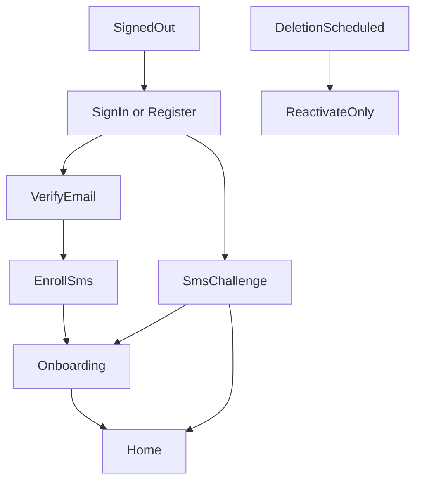

# Page and navigation map

**Status:** Source of truth for pages, routes, and navigation nesting.
**Last updated:** 2026-09-30

Implementation and later plans must follow this file. If another document or plan disagrees, stop and raise the conflict before building. When the product decision changes, edit this file in the same change so it does not go stale.

Older route sketches in `Veteran_Claims_Buddy_Engineering_Handoff.md` are background. This file wins for what screens exist and how they nest. Do not scaffold screens from the handoff feature-folder list alone.

Three surfaces. Marketing is static HTML on `veteranclaimsbuddy.com`. The app is Flutter on `app.veteranclaimsbuddy.com`, iOS, and Android. Admin is a hidden area inside the Flutter web app, not a third site and not in the consumer navigation.

`www.veteranclaimsbuddy.com` redirects to the marketing root. Marketing `/sign-in` and `/get-started` leave the static site and open the app. Legal pages live only on the marketing site. The app links out to them.

## How someone reaches Home



Nothing in the shell is reachable until email is verified and SMS MFA is enrolled. A deletion-pending account can sign in only to the reactivate page. A lost phone lands on a support-contact page. Email password reset does not skip the SMS challenge.

## Marketing site

```text
veteranclaimsbuddy.com
  /                         Home. Outcome, disclaimer, links into the app
  /how-it-works
  /pricing                  $250 Case, $30 Premium, Print & Mail described separately
  /va-disability-calculator Hardcoded rate table for now. This is the calculator
  /faq
  /support                  Published support email
  /sign-in                  Redirect to the app
  /get-started              Redirect to app registration
  /privacy
  /terms
  /terms/subscription
  /terms/refunds
  /terms/print-and-mail     One price, service fee, card fee, non-refundable once paid
  /ai-disclosure
  /account-deletion
```

The independent-product disclaimer is on the marketing home, these legal pages, and app registration. It is not repeated on every app screen.

## App gates

These sit outside the shell.

```text
app
  /sign-in
  /register
  /verify-email
  /forgot-password
  /reset-password              Email link handler
  /mfa/enroll
  /mfa/challenge
  /account/reactivate          Deletion grace period only
  /account/recovery            Lost phone. Contact support. No self-serve bypass
```

## Onboarding

Shown once, after MFA, before Home. Order is fixed. Skipping is not allowed.

```text
/onboarding
  /welcome                     What the app does, Veteran-only account
  /service                     Service periods
  /deployments
  /exposures                   Suggestions stay unconfirmed until the Veteran accepts them
  /discovery                   Symptom-oriented condition discovery
  /review                      Potential conditions. Nothing is filed from here
```

Legal name, date of birth, SSN, and VA file number are not collected here. They are collected later, only when a form needs them.

Finishing onboarding opens Home. The first case is created for them and shown as Open Case. They are not asked to name it. Quick links and the plans page are still there.

## App shell

Primary navigation after onboarding:

- Home
- Case (the current working Case)
- Vet Buddy
- You

```text
/home
  Current working Case status
  The single next action
  Open tasks
  Deadlines from background Cases, without private medical detail
  The first case is created at the end of onboarding and shown as Open Case
  Entry to Vet Buddy
  Quick links
    Calculator                         Opens /calculator
    Add symptom event                  Premium check on tap
                                         active  -> /symptoms/events/new
                                         inactive -> /plans?reason=symptoms
    Other short utilities as they exist
  Premium widget                       Hidden once Premium is active
                                       Otherwise opens /plans?reason=home

/cases
  List of Cases
  Switch the current working Case
  Starting another case is a later workflow. The list does not ask for a name
  or explain a case cap.

/cases/:caseId                          The Case tab opens the current working Case
  /overview
  /issues
    /:issueId
      /summary
      /evidence                         Matrix for this issue
      /questions                        Same questionnaire runner as everywhere else
      /statements
        /lay                            Veteran lay statement, 21-4138 / 21-10210
        /doctor-draft                   Draft for their doctor. Not a finished medical opinion
      /decisions
  /evidence
    /upload
    /:documentId
      /details                          Type, date, reclassify
      /facts                            Confirm or correct extracted facts
      /processing                       Status while the file is read
  /prepare                              Pick a workflow. One runner, many form definitions
    /intent-to-file                     21-0966
    /initial-claim                      21-526EZ
    /supplemental                       20-0995
    /higher-level-review                20-0996
    /board                              10182
    /unemployability                    21-8940 and 21-4192
    /mental-health-event                21-0781
    /records-release                    21-4142 and 21-4142a
    /records-request                    20-10206
    /identifiers                        SSN or VA file number, only when that form needs it
  /package
    /generate                           Blocked without Premium or a paid unlock for this Case
                                       Opens /plans?reason=package&caseId=... and returns here after purchase
    /review                             Every regenerated file must be reviewed again
    /approve
    /download                           Already-generated files stay available after Premium ends
    /submit                             VA.gov or mail instructions and a checklist. No VA filing API
    /print
      /contents                         What will be printed. Black and white, single sided
      /address
      /price                            One Stripe total. Quote plus $9.95 plus card fee, not itemized
      /pay                              Stripe only. Non-refundable once paid
      /status
  /exams
    /new
    /:examId
      /details
      /prep                             Reuses answers already given
      /travel                           VA facility vs contractor guidance
  /decisions
    /upload
    /:decisionId                        Confirm the parsed result before the Case changes
  /timeline
  /tasks

/buddy
  /                                     Chat list
  /:chatId                              Can be opened from an issue, document, exam, or decision
                                        Footer on every assistant reply
                                        Document search uses stored records, not the raw file

/plans                                  Shared purchase explanation. Not a tab
  What the $250 Case unlock includes
  What Premium includes while active
  What stops when Premium ends, and what already-generated files still do
  Start Premium                        Purchase from this page
  Unlock this Case for $250            Shown only when opened with a caseId that is not already paid
  After purchase, return to the screen that opened /plans

/calculator                             In-app viewer of the marketing calculator. Does not write to the Case
                                        Reachable from Home and from You

/symptoms                               Premium to create. Readable after Premium ends
  /check-in                             Same Premium check as Add symptom event
  /events/new
  /:entryId
  /summaries/:summaryId                 Veteran confirms before it is used anywhere else

/you
  Links to /calculator and /symptoms
  /support
    /new
    /:ticketId
  /billing
    /premium                            Status, renewal, manage on Apple, Google, or web
                                       Link to /plans when Premium is not active
    /cases                              Which Cases are unlocked. Restore purchases
  /settings
    /profile
    /security                           Password, enrolled phone factors
    /notifications
    /delete                             Explicit warning, then the 30-day scheduled state
  /legal                                Links out to the marketing legal pages
```

Push notifications open an existing page. Exam reminder opens that exam. A task reminder opens Home or that task. There is no notification inbox. Lock-screen text stays generic.

Vet Buddy is also a button from Home, an issue, a document, an exam, and a decision. Those open a chat with that context. They are not extra pages.

The questionnaire runner, the identifier step, and Print & Mail are steps inside the Case. They are not primary tabs.

`/plans` is the only page that explains and sells Premium versus paying per Case. Home, symptom creation, package generation, and billing all open that same page. They do not each carry their own sales screen. A `reason` and optional `caseId` tell the page which purchase to emphasize and where to return.

## Admin

Web only. A signed-in user without an admin role never sees the entry. Mobile shows an unavailable state if the URL is opened. No screens for granting roles. That stays a script.

```text
/admin
  /support
    /:ticketId
  /users
    /:uid                               Safe identifiers, billing, orders, processing status
                                        No medical-record reader
  /billing
  /print-orders
    /:orderId
  /forms
    /revisions
    /catalogs
    /releases
  /processing
  /security
    /reset-phone                        Audited MFA reset after an identity check
```

## What Home is for

Home is the landing page after sign-in. It is not a second copy of the Case, and it is not the marketing site.

It shows the current working Case, the next thing to do, and any deadline that matters on a background Case. Every task row opens a page that already exists in the tree: a task, the package, an exam, a decision, Vet Buddy, or the Case list.

Below that, Home has quick-link widgets. The calculator opens the calculator. Add symptom event checks Premium on tap, then either starts the event or opens `/plans`. A Premium widget opens `/plans` for the full comparison and the purchase. That widget is omitted when Premium is already active.
