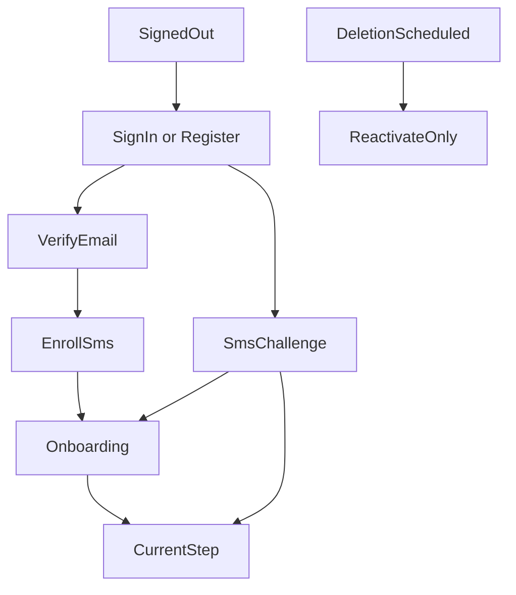

# Page and navigation map

**Status:** Source of truth for pages, routes, and navigation nesting.
**Last updated:** 2026-10-16

Implementation and later plans must follow this file. If another document or plan disagrees, stop and raise the conflict before building. When the product decision changes, edit this file in the same change so it does not go stale.

Older route sketches in `Veteran_Claims_Buddy_Engineering_Handoff.md` are background. This file wins for what screens exist and how they nest. Do not scaffold screens from the handoff feature-folder list alone.

Three surfaces. Marketing is static HTML on `veteranclaimsbuddy.com`. The app is Flutter on `app.veteranclaimsbuddy.com`, iOS, and Android. Admin is a hidden area inside the Flutter web app, not a third site and not in the consumer navigation.

`www.veteranclaimsbuddy.com` redirects to the marketing root. Marketing `/sign-in` and `/get-started` leave the static site and open the app. Legal pages live only on the marketing site. The app links out to them.

## How someone reaches the claim



Nothing in the shell is reachable until email is verified and SMS MFA is enrolled. A deletion-pending account can sign in only to the reactivate page. A lost phone lands on a support-contact page. Email password reset does not skip the SMS challenge.

## Marketing site

```text
veteranclaimsbuddy.com
  /                         Home. Outcome, disclaimer, links into the app
  /how-it-works
  /pricing                  $250 Case, $29.99/mo or $234.99/yr Premium, Print & Mail described separately
  /va-disability-calculator Hardcoded rate table for now. This is the calculator
  /faq
  /support                  Published support email
  /sign-in                  Redirect to the app
  /get-started              Redirect to app registration
  /privacy
  /terms
  /terms/subscription
  /terms/refunds
  /terms/print-and-mail     One price, service fee, card fee, non-refundable once paid
  /ai-disclosure
  /account-deletion
```

The independent-product disclaimer is on the marketing home, these legal pages, and app registration. It is not repeated on every app screen.

## App gates

These sit outside the shell.

```text
app
  /sign-in
  /register
  /verify-email
  /forgot-password
  /reset-password              Email link handler
  /mfa/enroll
  /mfa/challenge
  /account/reactivate          Deletion grace period only
  /account/recovery            Lost phone. Contact support. No self-serve bypass
```

## Onboarding

Shown once, after MFA, before the claim. Order is fixed. Skipping is not allowed.

```text
/onboarding
  /welcome                     What the app does, Veteran-only account, name, date of birth, and mailing address
  /service                     Service periods
  /deployments
  /exposures                   Suggestions stay unconfirmed until the Veteran accepts them
  /review                      Service history. Nothing is filed from here
```

Welcome asks for first, middle, and last name, date of birth, and mailing address. That name, date, and address are the ones used on forms. SSN and VA file number are collected later, only when a form needs them.

The symptom questionnaire is not an onboarding step. Finishing review creates the claim and opens its current step. The Veteran is not asked to name it.

## App shell

There is no separate Home. After onboarding, the app opens the open claim. That screen is the current step.

A wide window keeps navigation on the left. A phone keeps that same list in the navigation drawer. The claim name is a parent that opens and closes. Under it, indented, are eight sections: Case Info, Questions, Issues, My Uploads, Forms, Package, C&P Prep, and Decisions. C&P Prep comes after the package, because a compensation and pension exam is scheduled after the VA has the claim. Any section can be opened. A section that has not started is muted. A section in progress uses the primary label. A finished section is a check with muted text. The Symptoms Tracker and the VA Ratings Calculator sit below the claim, not inside it, and they are not in the account menu.

Account, billing, security, support, notifications, and legal open from the account menu. A purchase still opens `/plans`, and only when that step needs it.

Vet Buddy is a chat bubble on the claim. It is not a section. One thread stays on the claim. A session keeps the claim as it was when the session started. After the session ends, the next message reads the claim again and does not include the earlier turns. A reply can open a claim screen. It does not change the claim. Every reply keeps the safety footer.

The stored record is still a Case. The screens say "your claim." The open claim is the one that opens after sign-in. A finished claim stays the open claim, so the Veteran can look through it and download what was already made. Starting another claim makes that new claim the open one. Earlier claims stay available from the account menu, for looking and downloading. Opening an earlier claim does not replace the open one. The list does not ask for a name or explain a cap. Starting another claim is a later workflow.

```text
/home                                 Opens the open claim. Not a second page.

/cases
  Earlier claims, from the account menu, once more than one exists
  Opening one shows that claim. It does not become the open claim.
  Active claims and completed claims are listed separately. A completed
  claim is always viewable and downloadable, even after the entitlement ends.

/cases/:caseId                          The open claim, or an earlier claim being viewed
  Case Info                            Always this label
    First claim                        Stays on Case Info. Prepare Intent
                                       to File is on this page. Continue
                                       opens Questions.
    Not the first claim                Stays on Case Info. The two choices
                                       stay on screen. Case Info asks for an
                                       optional VA file number only after
                                       this answer. Supplemental Claim
                                       is where the earlier decision is added.
                                       New claims is a separate section in
                                       My Uploads. Upload is into the app.
                                       Nothing is automatically filed with
                                       the VA at any point.
    Prepare Intent to File             Opens /cases/:caseId/intent. Case Info
                                       stays selected. The page is the
                                       watermarked preview of VA Form 21-0966.
                                       Download form uses the same check
                                       dialog as the Forms page. Back returns
                                       to Case Info. There is no Continue.
                                       This is not the Forms page.
  Left navigation
    Claim name                         Not a section
    Case Info                          Opens this claim's case info step
    Questions                          Opens /questions. The symptom questionnaire.
                                       When every topic is answered, the list says
                                       the answers point to conditions that can
                                       likely be added. Add all to this claim adds
                                       the ones not already on it. A condition on
                                       the claim wears Added to claim and can be
                                       removed. Removing leaves its notes. Each
                                       condition can reopen its own questions, and
                                       Back or Continue returns to that list.
                                       Continue on the list opens Conditions.
    Conditions                         Opens /conditions. This lists the conditions chosen on the questions review. A condition is on the claim only after the Veteran adds it
      /:conditionId                    The condition stays on screen. Nothing is filed.
                                       Opening it starts on the first part that is not filled in. A finished condition opens on its last open part. A saved connection counts as filled. A doctor letter the filing does not need is skipped.
                                       A wide pane keeps the part cards on the left and the open part on the right.
                                       A narrow pane hides those cards and shows a numbered step rail. A finished part has a check. The current part is filled. A locked part is muted. The rail scrolls and centers the current part.
                                       Back on Questions about this returns to the conditions list. Back on a later part returns to the previous open part. Continue saves the open part and opens the next open part. A closed part is skipped, and the last part returns to the conditions list.
        /questions                     The topic questions for this condition
        /decisions                     New or already decided. Under Questions about this. The two choices are tabs, and the next question sits inside the selected tab. Continue is the footer. A new condition asks whether to pursue disability compensation. A decision already received keeps the date, outcome, rating, and effective date, then leave it, it got worse, or disagree. Disagree can become a Supplemental Claim, a Higher-Level Review, or a Board Appeal. Forms and a nexus letter turn on only after that choice. Not on this claim, or leaving the decision, closes the parts below this one. Questions about this stays open. Not a prediction
        /evidence                      Redirects to /connection
        /connection                    How this connects to service. The path, then the Service Connection fact that path needs. Direct asks what happened in service. Secondary asks the other condition by name, rated or not on this claim. Aggravation asks what existed before service and what in service made it worse. Presumptive asks the service, place, or exposure. No diagnosis re-ask and no medical-link sentence. How often it happens and what it limits is the next part
        /statements
          /lay                         How this affects you. Frequency, duration, and impact. Not sent from here
          /doctor-draft                Nexus Letters. A short interview fills the gaps the saved facts leave, then two unsigned drafts are generated automatically: a letter for your own doctor and a statement you can sign yourself. Only when that filing needs one. Otherwise the screen says why
    My Uploads                         Opens /evidence
    Forms                              Opens /prepare
    Package                            Opens /package
    C&P Prep                           Opens /exams. After the package is sent
    Decisions                          Opens /decisions
  Chat bubble                          Vet Buddy, without leaving the section
  /overview                            Opens the current step of this claim
  /questions                           Symptom questionnaire for this claim. When every topic is answered, possible conditions can be added one by one or all at once. One already on the claim shows Added to claim and can be removed. Removing leaves its notes
  /prepare                             Guided Forms page. Forms are grouped by the filing each condition is in: New claims, Supplemental Claim, Higher-Level Review, and Board Appeal. A heading appears only when a condition is in that filing. Recommended forms stay inside that filing. Forms that are not recommended for this claim, and the other common forms, are one section called Other Common Forms. A card under that list opens the VA find-forms page. The nexus letter is one unsigned draft per condition that needs it, not a row on every claim. A form already on the claim wears Added. Opening a form opens /prepare/:formNumber beside that list. Nothing is filed
  /decisions                           Upload the letter. Confirm the reading before it is on the claim
  /conditions
    /:conditionId                      This condition stays on screen. Nothing is filed.
                                       Opening it starts on the first part that is not filled in. A finished condition opens on its last open part. A saved connection counts as filled. A doctor letter the filing does not need is skipped.
                                       A wide pane keeps the part cards on the left and the open part on the right.
                                       A narrow pane hides those cards and shows a numbered step rail. A finished part has a check. The current part is filled. A locked part is muted. The rail scrolls and centers the current part.
                                       Back on Questions about this returns to the conditions list. Back on a later part returns to the previous open part. Continue saves the open part and opens the next open part. A closed part is skipped, and the last part returns to the conditions list.
      /summary
      /questions                        The topic questions for this condition
      /decisions                        New or already decided. Under Questions about this. The two choices are tabs, and the next question sits inside the selected tab. Continue is the footer. A new condition asks whether to pursue disability compensation. A decision already received keeps the date, outcome, rating, and effective date, then leave it, it got worse, or disagree. Inside one year, disagree can be a Supplemental Claim, a Higher-Level Review, or a Board Appeal. After that year, only new evidence or a change in law continues. Forms and a nexus letter turn on only after that choice. Not on this claim, or leaving the decision, closes the parts below this one. Questions about this stays open. Not a prediction
      /evidence                         Redirects to /connection
      /connection                       How this connects to service. The path comes first: direct, secondary, a condition that existed before service, or one service may presume. Each path asks only its Service Connection fact. Secondary names the other condition in a text field, even when it is already rated and not on this claim. A current diagnosis and a linking sentence are not asked. An aggravation still saves what existed before service as an evidence note. The medical link is written later
      /statements
        /lay                            How this affects you. Frequency, duration, and what it keeps the Veteran from doing, saved as one statement. Not sent from here
        /doctor-draft                   Nexus Letters for this condition when the filing needs one. A short gap interview runs first and the preview is gated until it is complete, then both unsigned drafts are generated and can be refined by asking for changes in plain words. The Doctor draft and Your statement sit in a real tabbed view (AppTabs). Each tab's preview carries a floating Download PDF button pinned to its top-right, a clean unwatermarked print copy to sign. Changes go through Ask for a change; there is no Edit answers button once the letters exist. When the filing does not need one, the screen says why and does not draft one. An increase-only connection does not get one
  /evidence
    /upload                             PDF, JPEG, or PNG. Each filing that is on screen has its own drop target and file list. An earlier claim always shows New claims and Supplemental Claim, even before a condition is added. A first claim does not add an empty Supplemental Claim section. Records, Higher-Level Review, and Board Appeal appear when a condition or a saved file belongs there. A decision letter or DD214 is a record. Higher-Level Review and Board Direct Review do not take new files. Choosing or dropping a file starts the upload and shows progress. The file is listed after it is stored. A PDF page count is filled in after that. The file is read once
    /:documentId
      /details                          Type and date. Reclassify
      /facts                            Confirm, correct, or set aside a statement. The original stays
      /processing                       Status while the file is read. Not built
  /prepare                              Guided Forms page. Forms are grouped by filing. The recommender lists 21-526EZ for New claims, 20-0995 only after a condition chooses a Supplemental Claim, 20-0996 only for a Higher-Level Review, and 10182 only for a Board Appeal. It asks the Veteran nothing; the filing was chosen on the condition. A heading appears only after that condition is being pursued. Recommended forms stay inside that filing. An Intent to File that still needs to be sent stays in New claims. Forms that are not recommended, including an Intent to File the Veteran already sent, sit with the other common forms under Other Common Forms. A card under that list opens https://www.va.gov/find-forms/. A form already on the claim wears an Added badge. Nothing is filed
    /:formNumber                        Form page, beside the Forms list. A wide pane keeps the form list on the left, and an added form wears an Added badge with the copy count on that row. A narrow pane hides the form list. The form name sits above What this is, and an outlined close button at the top right returns to the forms list. The Added badge stays beside the page title. The page is the info card (what it is, where it goes) and the copies already in the package. Add to Package, or Add another, follows multiplicity. Intent to File (21-0966) is free: the list says Do this first until it is added, the page says Prepare this form, and Download form opens a check dialog. Download signed fills the signature and today's date. Download unsigned leaves them blank. The Social Security number typed there is not saved. Other forms can use that same dialog later; until a form's download is turned on, it has no button. A paid download goes to /plans?reason=form&caseId=... and does not open the dialog. Opening one copy is the next screen. Back stays pinned at the top. Edit entry shows only when the form has questions or a statement. Cancel and Save stay pinned for those, and for a 21-526EZ copy once a section draft is open. A form with nothing to type, including Disability compensation before any draft, opens the watermarked preview directly and has no save bar. Saved identity fills the PDF. The Veteran does not type into the other blanks. Nothing is filed by the app
    (nexus letter)                      Evidence, not a form, so it has no form number. Two unsigned drafts per condition, called Nexus Letters. A new claim uses a direct, secondary, or aggravation letter. A Supplemental Claim or a Board evidence or hearing lane uses a letter only when the decision was missing a medical link. A presumptive condition, an increase, a change in law, a Higher-Level Review, and Board Direct Review do not get one. The app never signs either. A short interview asks one grounded gap question at a time; when it is complete, both are generated from the facts saved on the condition. The doctor draft is a scaffold letter titled Nexus Letter for the physician, with a Clinical summary, diagnosis and medical rationale left as blank writing space, and the opinion as a check-one yes/no pair, plus an optional Suggested Draft page carrying suggested diagnosis and rationale and a Relevant medical literature list. The veteran statement is a plain-language legal argument the Veteran can sign, with a Legal & Medical Citations section (each citation in regular type over an italic description, de-duplicated) and a Closing Remarks paragraph. Citations combine the general legal standards with the matched condition's curated legal and medical citations, injected by the server; the model never writes a citation. A presumptive note appears when the condition matches one, saying a presumptive claim can be granted without a paid nexus letter. Both carry a Subject line and the branch of service. Both are watermarked read-only previews refined by asking for changes in plain words, with a Download copy button for a clean unwatermarked print copy; the drafts are generated on the server and stored per condition
    /supplemental                       20-0995. Shown for the condition that chose a Supplemental Claim. The form is not filled here
    /higher-level-review                20-0996. Informal conference. Only while the decision is inside one year, and only for the condition that chose it. The form is not filled here
    /board                              10182. Docket. Only while the decision is inside one year, and only for the condition that chose it. The form is not filled here
    /identifiers                        Legal name, date of birth, SSN, VA file number, and phone, collected only when a form needs them. Masked inputs. Stored in a protected users/{uid}/identifiers/profile doc, never filed from here
    Generated forms live at users/{uid}/generatedForms/{id} (section 37). A generated PDF is an output, never the canonical record
  /package                              The live tracker of every form added to this claim, grouped by filing and then by form. Each packet is sent on its own. Opening an entry returns to its form detail. Generating the filled PDFs is a paid step; how the Veteran submits it is open. Nothing is filed
    /generate                           Entitlement gate. Unlocked for this case -> submit instructions. Otherwise -> /plans?reason=package&caseId=...
    /review                             Every regenerated file must be reviewed again. Not built
    /approve
    /download                           Already-generated files stay available after Premium ends. Not built
    /submit                             VA.gov or mail instructions and a checklist. No VA filing API
    /print
      /contents                         What will be printed. Black and white, single sided
      /address
      /price                            One Stripe total. Quote plus $9.95 plus card fee, not itemized
      /pay                              Stripe only. Non-refundable once paid
      /status
  /exams                                C&P Prep. After the package is sent to the VA
    /new
    /:examId
      /details
      /prep                             Reuses answers already given
      /travel                           VA facility vs contractor guidance
  /decisions
    /upload
    /:decisionId                        Confirm the parsed result before the Case changes.
                                        After confirming, a prompt offers Complete or Appeal.
                                        Appeal is offered only for a full denial or a reduction;
                                        a deferral stays pending; a grant or increase is complete-only.
                                        Completing frees the single Case-unlock slot.
  /timeline                             Exams, confirmed decisions, and review drafts. Nothing is filed
  /tasks

/buddy                                  Not a tab. The chat bubble opens the thread
  /:chatId                              One thread for this claim. A session keeps the snapshot from
                                        its first message. After the session ends, the next message
                                        reads the claim again and does not include the earlier turns.
                                        A reply can open a claim screen. It does not read the file,
                                        file a claim, or change the claim.
                                        Footer on every assistant reply

/plans                                  Shared purchase page. Not a tab. The only sales page
  Free workspace, Case unlock, and Premium compared
  Case unlock: $250 one-time. One year of Premium for a single active case
  Premium: $29.99 a month, or $234.99 a year (save 34%)
  What stops when the entitlement ends, and what completed cases still do
  Choose a plan                        iOS/Android present the RevenueCat Paywall (one offering, all 3).
                                        Web opens the hosted RevenueCat Web Purchase Link.
  A caseId in context records a Case-unlock purchase intent first, so the buy binds to that case
  After purchase, the server projection updates and the opening screen unlocks

/calculator                             VA Ratings Calculator. Its own section. Does not write to the Case

/symptoms                               Symptoms Tracker. Not the claim questionnaire.
                                        A check-in or an event records severity, duration,
                                        and a few yes or no impacts. It is not a diagnosis.
                                        Premium to create. Readable after Premium ends.
                                        A note and a photo are not on this form.
  /check-in                             Same Premium check as Add symptom event
  /events/new
  /:entryId
  /summaries/:summaryId                 A monthly summary is not ready. The Veteran
                                        confirms one before it is used anywhere else.

/you
  Account pages. The Symptoms Tracker and the VA Ratings Calculator are not here
  /support                            Email, plus tickets on this account
    /new                              Subject, category, and a message
    /:ticketId                          Replies stay on the ticket. Closed tickets stay readable
  /billing
    /premium                            Status and source (subscription vs Case unlock), renewal or expiry.
                                       Manage subscription (store or web portal). Restore purchases on mobile.
                                       Link to /plans when Premium is not active
    /cases                              Which Cases are unlocked and their status. Completed cases stay viewable
  /settings
    /profile                            First, middle, and last name, date of birth, mailing address, time zone, and the email and phone used on forms
    /security                           Password, enrolled phone factors
    /notifications                      Exam and task reminder choices. No inbox
    /delete                             Explicit warning, then the 30-day scheduled state
    /legal                                Names the marketing legal pages. Public URLs open
                                        after the marketing site is published.
```

Push notifications open an existing page. Exam reminder opens that exam. A task reminder opens Home or that task. There is no notification inbox. Lock-screen text stays generic.

Vet Buddy opens in the chat bubble from the current step, a condition, a document, an exam, or a decision. Those threads are not extra pages. A session stays open for `sessionMinutes` after the last message. That number is in `functions/vet_buddy_config.js`.

The questionnaire runner, the identifier step, and Print & Mail are steps inside the Case. They are not primary tabs.

`/plans` is the only page that explains and sells Premium versus paying per Case. Home, symptom creation, package generation, and billing all open that same page. They do not each carry their own sales screen. A `reason` and optional `caseId` tell the page which purchase to emphasize and where to return.

## Admin

Web only. A signed-in user without an admin role never sees the entry. Mobile shows an unavailable state if the URL is opened. No screens for granting roles. That stays a script.

```text
/admin
  /support
    /:ticketId
  /users
    /:uid                               Safe identifiers, billing, orders, processing status
                                        No medical-record reader
  /billing
  /print-orders
    /:orderId
  /forms
    /revisions
    /catalogs
    /releases
  /processing
  /security
    /reset-phone                        Audited MFA reset after an identity check
```

## What the claim screen is for

The claim screen is the current step of the open claim. It is not a dashboard, and it is not a separate Home.

One step is on screen. The eight claim sections are in the left navigation. The Symptoms Tracker is its own section. It is not the intake questionnaire. The VA Ratings Calculator is its own section. `/plans` opens when a step needs a purchase, and that widget is not part of the front door.

A finished claim stays open until another claim is started. Earlier claims open from the account menu for looking and downloading. The lock screen stays free of private medical detail.
