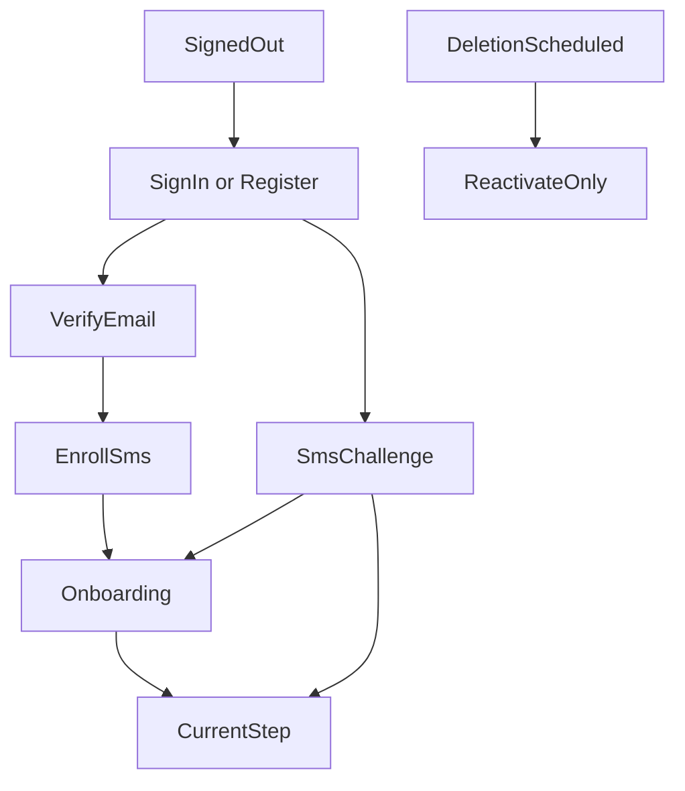

# Page and navigation map

**Status:** Source of truth for pages, routes, and navigation nesting.
**Last updated:** 2026-10-02

Implementation and later plans must follow this file. If another document or plan disagrees, stop and raise the conflict before building. When the product decision changes, edit this file in the same change so it does not go stale.

Older route sketches in `Veteran_Claims_Buddy_Engineering_Handoff.md` are background. This file wins for what screens exist and how they nest. Do not scaffold screens from the handoff feature-folder list alone.

Three surfaces. Marketing is static HTML on `veteranclaimsbuddy.com`. The app is Flutter on `app.veteranclaimsbuddy.com`, iOS, and Android. Admin is a hidden area inside the Flutter web app, not a third site and not in the consumer navigation.

`www.veteranclaimsbuddy.com` redirects to the marketing root. Marketing `/sign-in` and `/get-started` leave the static site and open the app. Legal pages live only on the marketing site. The app links out to them.

## How someone reaches the claim



Nothing in the shell is reachable until email is verified and SMS MFA is enrolled. A deletion-pending account can sign in only to the reactivate page. A lost phone lands on a support-contact page. Email password reset does not skip the SMS challenge.

## Marketing site

```text
veteranclaimsbuddy.com
  /                         Home. Outcome, disclaimer, links into the app
  /how-it-works
  /pricing                  $250 Case, $30 Premium, Print & Mail described separately
  /va-disability-calculator Hardcoded rate table for now. This is the calculator
  /faq
  /support                  Published support email
  /sign-in                  Redirect to the app
  /get-started              Redirect to app registration
  /privacy
  /terms
  /terms/subscription
  /terms/refunds
  /terms/print-and-mail     One price, service fee, card fee, non-refundable once paid
  /ai-disclosure
  /account-deletion
```

The independent-product disclaimer is on the marketing home, these legal pages, and app registration. It is not repeated on every app screen.

## App gates

These sit outside the shell.

```text
app
  /sign-in
  /register
  /verify-email
  /forgot-password
  /reset-password              Email link handler
  /mfa/enroll
  /mfa/challenge
  /account/reactivate          Deletion grace period only
  /account/recovery            Lost phone. Contact support. No self-serve bypass
```

## Onboarding

Shown once, after MFA, before the claim. Order is fixed. Skipping is not allowed.

```text
/onboarding
  /welcome                     What the app does, Veteran-only account
  /service                     Service periods
  /deployments
  /exposures                   Suggestions stay unconfirmed until the Veteran accepts them
  /review                      Service history. Nothing is filed from here
```

Legal name, date of birth, SSN, and VA file number are not collected here. They are collected later, only when a form needs them.

The symptom questionnaire is not an onboarding step. Finishing review creates the claim and opens its current step. The Veteran is not asked to name it.

## App shell

There is no separate Home. After onboarding, the app opens the open claim. That screen is the current step.

A wide window keeps navigation on the left. A phone keeps that same list in the navigation drawer. The claim name is a parent that opens and closes. Under it, indented, are eight sections: First claim or Earlier claim, Questions, Issues, Documents, Forms, Package, C&P Prep, and Decisions. C&P Prep comes after the package, because a compensation and pension exam is scheduled after the VA has the claim. Any section can be opened. A section that has not started is muted. A section in progress uses the primary label. A finished section is a check with muted text. The Symptoms Tracker and the VA Ratings Calculator sit below the claim, not inside it, and they are not in the account menu.

Account, billing, security, support, notifications, and legal open from the account menu. A purchase still opens `/plans`, and only when that step needs it.

Vet Buddy is a chat bubble on the claim. It is not a section. One thread stays on the claim. A session keeps the claim as it was when the session started. After the session ends, the next message reads the claim again and does not include the earlier turns. A reply can open a claim screen. It does not change the claim. Every reply keeps the safety footer.

The stored record is still a Case. The screens say "your claim." The open claim is the one that opens after sign-in. A finished claim stays the open claim, so the Veteran can look through it and download what was already made. Starting another claim makes that new claim the open one. Earlier claims stay available from the account menu, for looking and downloading. Opening an earlier claim does not replace the open one. The list does not ask for a name or explain a cap. Starting another claim is a later workflow.

```text
/home                                 Opens the open claim. Not a second page.

/cases
  Earlier claims, from the account menu, once more than one exists
  Opening one shows that claim. It does not become the open claim.

/cases/:caseId                          The open claim, or an earlier claim being viewed
  The current step                     First question, then one step at a time
    First claim                        Skip prior-claim paperwork
                                       Continue into the symptom questionnaire
    Not the first claim                Upload the earlier claim or decision
                                       paperwork for what they want to pursue
                                       again. They can also add new conditions
                                       in this same claim. Upload is into the
                                       app. Nothing is filed with the VA.
  Left navigation
    Claim name                         Not a section
    First claim or Earlier claim       Opens this claim's current first-claim step
    Questions                          Opens /questions. The symptom questionnaire
    Issues                             Opens /issues. A condition is added here only after the Veteran chooses it
      /:issueId                        The issue stays on screen. Nothing is filed.
                                       A wide pane opens one part in a card on the right.
                                       A narrow pane replaces the list with that form.
                                       Back closes the form.
        /questions                     The topic questions for this condition
        /evidence                      What this claim still needs. Missing pieces are one line
        /connection                    How it may be connected. Not a medical finding
        /statements
          /lay                         The Veteran's own words. Not sent from here
          /doctor-draft                A draft for their doctor. Not a finished medical opinion
        /decisions                     A decision already received. Not a prediction
    Documents                          Opens /evidence
    Forms                              Opens /prepare
    Package                            Opens /package
    C&P Prep                           Opens /exams. After the package is sent
    Decisions                          Opens /decisions
  Chat bubble                          Vet Buddy, without leaving the section
  /overview                            Opens the current step of this claim
  /questions                           Symptom questionnaire for this claim
  /prepare                             Supplemental Claim, Higher-Level Review, and Board Appeal. The other forms are not open yet. Nothing is filed
  /decisions                           Upload the letter. Confirm the reading before it is on the claim
  /issues
    /:issueId                          This issue stays on screen. Nothing is filed.
                                       A wide pane opens one part in a card on the right.
                                       A narrow pane replaces the list with that form.
                                       Back closes the form.
      /summary
      /evidence                         What this claim still needs. A note can be tied to one piece.
                                       Pieces with no note are named in one line.
      /questions                        The topic questions for this condition
      /connection                       How it may be connected. Not a medical finding
      /statements
        /lay                            Veteran lay statement, in their own words
        /doctor-draft                   Draft for their doctor. Not a finished medical opinion
      /decisions                        A decision already received. Not a prediction
  /evidence
    /upload                             PDF, JPEG, or PNG. Choosing a file starts the upload and shows progress. The file is listed after it is stored. A PDF page count is filled in after that. The file is read once
    /:documentId
      /details                          Type and date. Reclassify
      /facts                            Confirm, correct, or set aside a statement. The original stays
      /processing                       Status while the file is read. Not built
  /prepare                              Supplemental Claim, Higher-Level Review, and Board Appeal can be started as a draft. The other forms are not open yet. Nothing is filed
    /intent-to-file                     21-0966. Not open yet
    /initial-claim                      21-526EZ. Not open yet
    /supplemental                       20-0995. A draft review. The form is not filled
    /higher-level-review                20-0996. A draft review. The form is not filled
    /board                              10182. A draft review. The form is not filled
    /unemployability                    21-8940 and 21-4192. Not open yet
    /mental-health-event                21-0781. Not open yet
    /records-release                    21-4142 and 21-4142a. Not open yet
    /records-request                    20-10206. Not open yet
    /identifiers                        SSN or VA file number, only when that form needs it
  /package                              The digital package is not generated yet. How the Veteran submits it is open. Nothing is filed
    /generate                           Opens /plans?reason=package&caseId=... Buying is not open
    /review                             Every regenerated file must be reviewed again. Not built
    /approve
    /download                           Already-generated files stay available after Premium ends. Not built
    /submit                             VA.gov or mail instructions and a checklist. No VA filing API
    /print
      /contents                         What will be printed. Black and white, single sided
      /address
      /price                            One Stripe total. Quote plus $9.95 plus card fee, not itemized
      /pay                              Stripe only. Non-refundable once paid
      /status
  /exams                                C&P Prep. After the package is sent to the VA
    /new
    /:examId
      /details
      /prep                             Reuses answers already given
      /travel                           VA facility vs contractor guidance
  /decisions
    /upload
    /:decisionId                        Confirm the parsed result before the Case changes
  /timeline                             Exams, confirmed decisions, and review drafts. Nothing is filed
  /tasks

/buddy                                  Not a tab. The chat bubble opens the thread
  /:chatId                              One thread for this claim. A session keeps the snapshot from
                                        its first message. After the session ends, the next message
                                        reads the claim again and does not include the earlier turns.
                                        A reply can open a claim screen. It does not read the file,
                                        file a claim, or change the claim.
                                        Footer on every assistant reply

/plans                                  Shared purchase explanation. Not a tab
  What the $250 Case unlock includes
  What Premium includes while active
  What stops when Premium ends, and what already-generated files still do
  Start Premium                        Purchase from this page
  Unlock this Case for $250            Shown only when opened with a caseId that is not already paid
  After purchase, return to the screen that opened /plans

/calculator                             VA Ratings Calculator. Its own section. Does not write to the Case

/symptoms                               Symptoms Tracker. Not the claim questionnaire.
                                        A check-in or an event records severity, duration,
                                        and a few yes or no impacts. It is not a diagnosis.
                                        Premium to create. Readable after Premium ends.
                                        A note and a photo are not on this form.
  /check-in                             Same Premium check as Add symptom event
  /events/new
  /:entryId
  /summaries/:summaryId                 A monthly summary is not ready. The Veteran
                                        confirms one before it is used anywhere else.

/you
  Account pages. The Symptoms Tracker and the VA Ratings Calculator are not here
  /support                            Email, plus tickets on this account
    /new                              Subject, category, and a message
    /:ticketId                          Replies stay on the ticket. Closed tickets stay readable
  /billing
    /premium                            Status, renewal, manage on Apple, Google, or web
                                       Link to /plans when Premium is not active
    /cases                              Which Cases are unlocked. Restore purchases
  /settings
    /profile                            Name and time zone. Not a legal name
    /security                           Password, enrolled phone factors
    /notifications                      Exam and task reminder choices. No inbox
    /delete                             Explicit warning, then the 30-day scheduled state
    /legal                                Names the marketing legal pages. Public URLs open
                                        after the marketing site is published.
```

Push notifications open an existing page. Exam reminder opens that exam. A task reminder opens Home or that task. There is no notification inbox. Lock-screen text stays generic.

Vet Buddy opens in the chat bubble from the current step, an issue, a document, an exam, or a decision. Those threads are not extra pages. A session stays open for `sessionMinutes` after the last message. That number is in `functions/vet_buddy_config.js`.

The questionnaire runner, the identifier step, and Print & Mail are steps inside the Case. They are not primary tabs.

`/plans` is the only page that explains and sells Premium versus paying per Case. Home, symptom creation, package generation, and billing all open that same page. They do not each carry their own sales screen. A `reason` and optional `caseId` tell the page which purchase to emphasize and where to return.

## Admin

Web only. A signed-in user without an admin role never sees the entry. Mobile shows an unavailable state if the URL is opened. No screens for granting roles. That stays a script.

```text
/admin
  /support
    /:ticketId
  /users
    /:uid                               Safe identifiers, billing, orders, processing status
                                        No medical-record reader
  /billing
  /print-orders
    /:orderId
  /forms
    /revisions
    /catalogs
    /releases
  /processing
  /security
    /reset-phone                        Audited MFA reset after an identity check
```

## What the claim screen is for

The claim screen is the current step of the open claim. It is not a dashboard, and it is not a separate Home.

One step is on screen. The eight claim sections are in the left navigation. The Symptoms Tracker is its own section. It is not the intake questionnaire. The VA Ratings Calculator is its own section. `/plans` opens when a step needs a purchase, and that widget is not part of the front door.

A finished claim stays open until another claim is started. Earlier claims open from the account menu for looking and downloading. The lock screen stays free of private medical detail.
