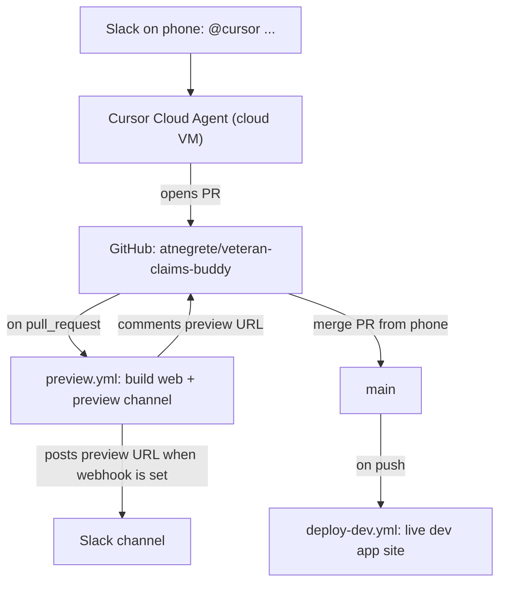

# Phone-driven preview pipeline

**Updated:** 2026-10-29

How to build from your phone and get a live web preview of every change, without a desktop. `docs/hosting.md` stays the source of truth for how the sites are hosted; this file is the iteration loop on top of it.

## The loop

1. From **Slack on your phone**, mention `@cursor <what you want>`. A Cursor **Cloud Agent** runs in Cursor's cloud (your Mac can be off), writes code on a branch, and opens a pull request.
2. The **Preview** GitHub Action ([.github/workflows/preview.yml](../.github/workflows/preview.yml)) builds the Flutter web app for dev and deploys it to a **Firebase Hosting preview channel** on the `app` site, then comments the ephemeral preview URL on the PR. When the `SLACK_WEBHOOK_URL` secret is set, the same job posts that URL to the Slack channel the webhook belongs to. That post does not wait on the agent, and it does not reply inside the Cursor thread. Slack also links the PR.
3. Open the preview URL on your phone. To iterate, reply in the same Slack thread; the agent pushes more commits and the preview updates.
4. **Merge the PR from your phone.** The **Deploy dev** Action ([.github/workflows/deploy-dev.yml](../.github/workflows/deploy-dev.yml)) then publishes the merged build to the live dev app site, `https://veteran-claims-buddy-dev-app.web.app`.

## What the Actions do and do not touch

- Both workflows build with `flutter build web --dart-define=APP_ENV=dev` (Flutter pinned to 3.47.5, matching [.github/workflows/check.yml](../.github/workflows/check.yml)) and deploy only the `app` hosting **target**.
- A preview deploy is a Hosting **channel** deploy: it never touches Functions, Firestore rules, indexes, Storage rules, or the marketing site. Merging to `main` is a live Hosting deploy of the `app` site only.
- **Prod is never touched** by either workflow. Both target `veteran-claims-buddy-dev`.
- Preview channels auto-expire after 7 days (`expires: 7d`).

## Secrets

Both workflows authenticate with the GitHub Actions secret `FIREBASE_SERVICE_ACCOUNT_VETERAN_CLAIMS_BUDDY_DEV` (a Firebase CI service-account JSON for the dev project). The web build itself needs no secret (dev Firebase config is committed in `app/lib/firebase_options_dev.dart`). Setup is **M14** in [build-progress.md](build-progress.md).

`SLACK_WEBHOOK_URL` is optional. It is a Slack incoming webhook. The Preview job posts the `.web.app` URL there when the secret is set, and skips the post when it is not. The webhook chooses the channel. The message is a new channel post, not a reply in the Cursor thread. A failed Slack post does not fail the preview.

## The Cloud Agent environment

[.cursor/environment.json](../.cursor/environment.json) runs [.cursor/install.sh](../.cursor/install.sh) once per agent VM: it installs the pinned Flutter SDK and runs `npm ci` (root and `functions/`) and `flutter pub get` (`app/`). That lets the agent run `flutter analyze`, `flutter test`, and `npm test` before opening a PR, so PRs tend to land green. `check.yml` remains the authoritative gate.

Tip: in a running agent you can `/subscribe` to the PR's CI results so the agent wakes and fixes a red check on its own.
